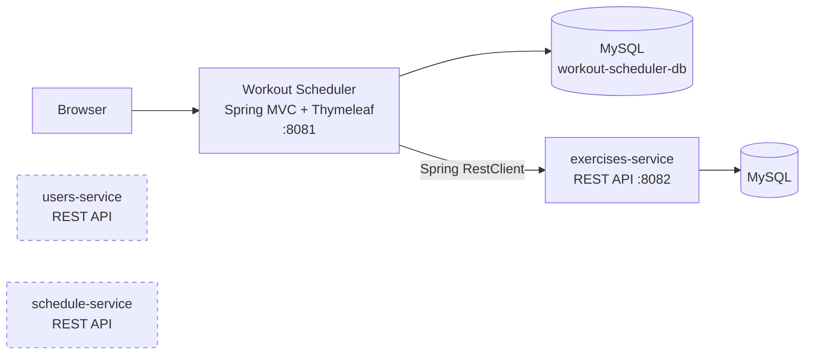

# Workout Scheduler

A web application for planning training: build workouts from a shared exercise library, schedule them through the day, and keep the library curated through an admin review flow.

Built with **Java 21** and **Spring Boot 3.5** as a server-rendered Spring MVC app, currently being split into independent REST microservices.

## Features

- **Exercise library**: search exercises by target body part (17 muscle groups), complexity and movement type (compound / isolation), with paginated results and image galleries.
- **Community submissions with admin review**: users can propose new exercises; admins approve or reject them from a review queue.
- **Workouts**: create workouts with a type (weightlifting, bodybuilding, cardio, CrossFit, calisthenics…), intensity and volume, then add, edit and remove exercises.
- **Schedules**: a daily view of the day's workouts by time of day (morning / afternoon / evening).
- **Accounts**: registration, login, profile editing and password change, secured with Spring Security and BCrypt.

## Architecture



The application started as a monolith and is being decomposed service by service. Exercise management already runs as a separate service; users and schedules are next (dashed above).

| Repository | Responsibility |
|---|---|
| [workout-scheduler-app](https://github.com/DimitarRadev88/workout-scheduler-app) | Web UI, users, workouts, schedules (this repo) |
| [exercises-service](https://github.com/DimitarRadev88/exercises-service) | REST API for exercises and their images (Spring HATEOAS) |
| [users-service](https://github.com/DimitarRadev88/users-service) | REST API for users, roles and password reset tokens |
| [schedule-service](https://github.com/DimitarRadev88/schedule-service) | REST API for user schedules |

## Tech stack

- **Backend:** Java 21, Spring Boot 3.5 (Web MVC, Data JPA, Security, Validation), Hibernate, Lombok
- **Frontend:** Thymeleaf, Thymeleaf Extras Spring Security, Bootstrap
- **Database:** MySQL (H2 for tests)
- **Testing:** JUnit 5, Mockito
- **Build:** Maven (wrapper included)

## Getting started

### Prerequisites

- JDK 21+
- MySQL 8 running on `localhost:3306`
- [exercises-service](https://github.com/DimitarRadev88/exercises-service) running on port `8082` (needed for the exercise pages)

### Run

1. Clone the repository:
   ```bash
   git clone https://github.com/DimitarRadev88/workout-scheduler-app.git
   cd workout-scheduler-app
   ```
2. Set your MySQL username and password in `src/main/resources/application.properties` (`spring.datasource.username` / `spring.datasource.password`). The `workout-scheduler-db` database is created automatically.
3. Start the application:
   ```bash
   ./mvnw spring-boot:run
   ```
4. Open <http://localhost:8081>.

On first start the `USER` and `ADMIN` roles are seeded and a default admin account is created. The username is `user` and the password is `password`. Change it after logging in.

### Tests

```bash
./mvnw test
```

## Project structure

The code is organised by feature rather than by layer:

```
src/main/java/com/dimitarrradev/workoutScheduler
├── config/            # Spring Security configuration
├── exercise/          # Exercise client, models and service
├── workout/           # Workouts: entity, repository, service
├── workoutExercise/   # Exercises within a workout
├── schedule/          # Daily schedules
├── program/           # Training programs (in progress)
├── user/ , role/      # Accounts and roles
└── web/               # MVC controllers and global exception handling
```

## Roadmap

- [ ] Weekly schedule view
- [ ] Goal-based training programs (strength, endurance, speed…)
- [ ] Move users and schedules to their microservices
- [ ] Docker Compose setup for one-command startup
